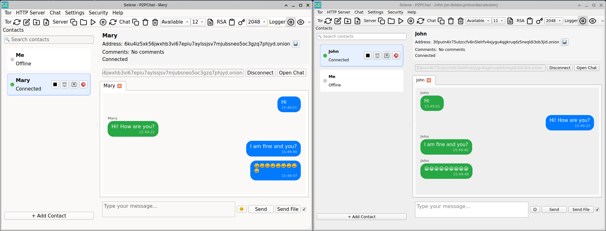

# Selene

**Selene** is a comprehensive peer-to-peer chat and file sharing application built on the Tor network.  
It enables secure, private communication and seamless file transfers between users, leveraging the anonymity and resilience of Tor.

## Download Options

| Platform | Where to Get It |
| :--- | :--- |
| **Linux** | [Flathub](https://flathub.org/en/apps/search?q=alamahant) |
| **Windows and Mac** | [Buy on Gumroad](https://jnanadhakini.gumroad.com/) - Pre-compiled binary, no compilation needed |

---

## Distribution

- **Flatpak:**  
  The initial release of Selene will be available on [Flathub](https://flathub.org/).
- **AppImage & Windows:**  
  Releases for AppImage (Linux) and Windows will follow in the future.

---

## Key Features

- **True Peer-to-Peer Messaging:**  
  Messages travel exclusively over the Tor network, never leaving Tor at any point.

- **End-to-End RSA Encryption:**  
  Messages are encrypted with selectable key lengths: 2048, 4096, or 8192 bits.

- **File Sharing via Ephemeral Tor Hidden Service HTTP Servers:**  
  Recipients access files directly using the provided onion address in Tor Browser or any Tor-enabled private window.

- **Peer-to-Peer Mail Over Tor:**  
  Send and receive real email at `<you>@<your-onion>.onion` with no account, no relay, and no third-party server. Your mail server is the app itself — direct SMTP delivery peer to peer through Tor.

- **One-Way Dropbox Over Tor:**  
  Share a drop link and anyone can send you a file through Tor Browser, no account needed. Files land in your Downloads folder, every upload is logged, and the link works only while you keep it open.

---

## Feature Highlights

- **Request New Tor Circuit:**  
  Instantly request a new Tor circuit to improve connectivity and reduce delays, ensuring reliable communication even in challenging network conditions.

- **Configurable Tor Ports:**  
  Flexibly edit Tor ports for chat, HTTP, control, and proxy services. This is especially useful when running multiple Tor daemons or other Tor-based applications in parallel.

- **Onion Service Management:**  
  Easily request new onion addresses for both chat and HTTP services, enhancing privacy and operational flexibility.

- **Customizable Chat Status & Font Size:**  
  Set your chat status as 'Available' or 'Away' and adjust chat font size via intuitive combo boxes for a personalized experience.

- **Contact Export & Import:**  
  Export your contact information to a `.contact` file for easy sharing. Recipients can simply drag and drop the file into the UI to add contacts, with manual addition also supported.

- **Tor-native End-to-End Encryption:**  
  All communication remains strictly within the Tor network, leveraging Tor's built-in encryption for maximum privacy. Additionally, users may enable extra RSA encryption (2048–8192 bits) for messages, providing an extra layer of security.

- **Advanced Logging System:**  
  Comprehensive logging captures extensive data for diagnostics and auditing. Includes a powerful log viewer with search and truncation capabilities, plus options to enable/disable logging for optimal performance.

- **Rich Messaging & File Sharing:**  
  Send plain or encrypted messages, share emojis via a dedicated emoji class, and transfer files seamlessly. Files placed in `~/Documents/Selene/www` can be shared via an ephemeral onion HTTP server, with the onion URL easily accessible from the toolbar. Direct file sharing in chat is supported via file dialog, with automatic secure link generation for recipients.

- **Per-Peer Encryption Control:**  
  Enable or disable additional encryption for each peer using a simple checkbox, tailoring security to your needs.

- **Factory Reset:**  
  Restore the app to its original state with a single action. All data is wiped except for contacts and shared files stored in `~/Documents/Selene`.

- **Quick Access Toolbar:**  
  Convenient toolbar buttons allow instant copying of your chat onion, HTTP onion, and shared directory paths to the clipboard.

- **Chat History Management:**  
  Easily clear chat messages and history per peer or for all peers. Optionally enable automatic history cleaning at app startup for enhanced privacy.

- **Password Protection at Startup:**  
  Enhance your privacy with optional password protection. When enabled, Selene requires a master password at startup to access your data. The system supports secure password creation, change, and validation, with robust SHA-256 hashing and salting. After multiple failed attempts, users can choose to exit or perform a factory reset. Password protection can be enabled or disabled at any time for flexible security management.

- **Mail — Compose, Inbox, Attachments:**  
  A full mail tab: Compose with To/Subject/Body and an active-account selector, Sent and Failed lists with one-click retry, and an Inbox that updates live as messages arrive. Attachments are staged on your HTTP onion and shared as links in the message body. New mail plays a sound. The receiver starts and stops from a single button on the Inbox tab — it runs only when you want it to.

- **Dropbox — Anonymous One-Way Uploads:**  
  Enable the Dropbox site and share its onion URL. Anyone who opens it in Tor Browser sees a simple upload form and can send you a file without a Tor account, a Selene install, or knowing who you are. Uploads land in your Downloads folder under their original name (with a prefix added if a file with that name already exists), and each one is recorded in `dropbox.log` with the time, the drop link, the filename, and the size. Disable the site or stop the app to revoke access.

---

## Platform

- **Built with:** Qt Framework
- **Platform:** Cross-platform (Linux, Windows, others via Qt)

---

## About

Selene is designed for privacy advocates and secure communication enthusiasts, offering a robust suite of features for confidential, flexible, and user-friendly Tor-based messaging and file sharing.

---

## License

This program is free software: you can redistribute it and/or modify  
it under the terms of the GNU General Public License as published by  
the Free Software Foundation, either version 3 of the License, or  
(at your option) any later version.

This program is distributed in the hope that it will be useful,  
but WITHOUT ANY WARRANTY; without even the implied warranty of  
MERCHANTABILITY or FITNESS FOR A PARTICULAR PURPOSE. See the  
GNU General Public License for more details.

You should have received a copy of the GNU General Public License  
along with this program. If not, see <https://www.gnu.org/licenses/>.

**Copyright © 2025 Alamahant**

---

## Credits

**Framework:**  
- Qt Framework (https://www.qt.io/)  
  Licensed under LGPL v3  
  Copyright (C) The Qt Company Ltd.

**Icons:**  
- Feather Icons (https://feathericons.com/)  
  Licensed under MIT License  
  Copyright (c) 2013-2017 Cole Bemis

**Sounds:**  
- Bell sound effects by Mixkit (https://mixkit.co/free-sound-effects/bell/)  
  Licensed under the Mixkit Sound License (https://mixkit.co/license/)

**Noto Color Emoji Font**  
  [https://fonts.google.com/noto/specimen/Noto+Color+Emoji](https://fonts.google.com/noto/specimen/Noto+Color+Emoji)  
  Licensed under the SIL Open Font License, Version 1.1  
  Copyright © 2013 Google Inc.

